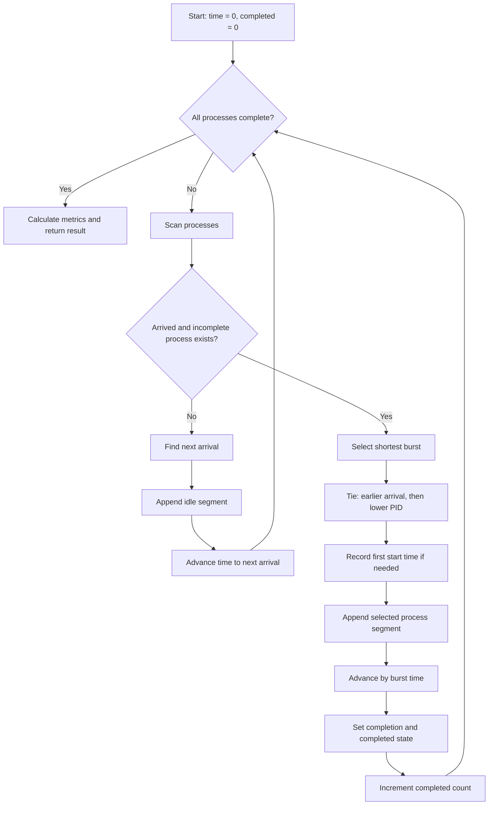

# CPU Scheduling Simulator (SJF)
## Using React, TypeScript and C Compiled to WebAssembly

### B.Tech Project Report

**Student Name:** Jatin Trivedi 
**Roll Number:** 2506075  
**Course:** Operating System  
**College:** NIT Patna 
**Academic Year:** 2026-27

---

## Certificate

This is to certify that the project report entitled **“CPU Scheduling
Simulator (SJF) using React, TypeScript and C compiled to WebAssembly”** is a
record of the project work carried out by **[Your Name]**, Roll Number
**[Your Roll Number]**, in partial fulfilment of the requirements for the
award of the Bachelor of Technology degree in **[Course Name / Code]**.

The work was completed under the guidance of **[Guide Name]** at
**[College Name]** during the academic year **[Academic Year]**.

| Signature | Name and designation | Date |
|---|---|---|
| ____________________ | Project Guide: [Guide Name] | __________ |
| ____________________ | Head of Department | __________ |
| ____________________ | External Examiner | __________ |

---

## Acknowledgement

I express my sincere gratitude to **[Guide Name]** for guidance, feedback,
and encouragement throughout the development of this project. The discussions
on operating-system scheduling, implementation structure, and testing helped
shape the project into a clear separation between the user interface and the
scheduling engine.

I thank the faculty members of **[Department / College Name]** for providing
the academic foundation required to study process scheduling, performance
metrics, and systems programming. I also acknowledge the support of my
classmates, friends, and family during the design, implementation, testing,
and documentation stages of the work.

Finally, I acknowledge the open-source technologies used in the project:
React, TypeScript, Vite, C11, Emscripten, Vitest, jsdom, and React Testing
Library. Their documentation and tooling made it possible to connect a native
C scheduling engine with a browser-based educational interface.

---

## Abstract

CPU scheduling determines the order in which ready processes receive
processor time and directly affects waiting time, turnaround time, response
time, utilization, and throughput. This project presents an interactive CPU
Scheduling Simulator focused on non-preemptive Shortest Job First (SJF), with
preemptive Shortest Remaining Time First (SRTF) included for comparison. The
user interface is implemented with React and TypeScript, while the scheduling
algorithms, Gantt-segment generation, and scheduling metrics are implemented
in modular C. Emscripten compiles the C engine to WebAssembly, allowing the
browser interface to execute the same scheduling logic through a flat,
typed-array application programming interface.

The system accepts process identifiers, arrival times, and burst times; validates
the input; invokes the C engine; and visualizes the returned execution timeline,
per-process metrics, aggregate analytics, and playback state. CSV import and
export support workload and result exchange, while browser-local history stores
completed simulations without a backend. The implementation uses deterministic
tie-breaking, explicit idle intervals, dynamic Gantt storage, and native and
frontend automated tests. The project demonstrates how a systems-oriented C
component can be integrated safely with a modern web interface without
duplicating scheduling logic in TypeScript.

**Keywords:** CPU scheduling, SJF, SRTF, React, TypeScript, C, WebAssembly,
Emscripten, Gantt chart, operating systems.

---

# 1. Introduction and Objectives

## 1.1 Introduction

An operating system must decide which ready process should receive the CPU
when multiple processes compete for execution. This decision is made by a
scheduler. A scheduling policy changes the order of execution and therefore
changes the time processes spend waiting, the time required to complete them,
the responsiveness observed by users, and the utilization of the processor.

Scheduling algorithms are often introduced with tables and static examples.
Although those representations are useful, they can make it difficult for a
learner to connect an input workload with the actual sequence of scheduling
decisions. A simulator provides a direct relationship between process input,
algorithm choice, Gantt chart, per-process results, and aggregate metrics.

This project develops such a simulator with an explicit systems architecture.
The interface is a React application written in TypeScript. It is responsible
for user input, validation presentation, navigation, playback, and
visualization. The scheduling engine is written in C11 and compiled to
WebAssembly using Emscripten. The C engine remains authoritative for process
selection, Gantt segments, and metrics. The TypeScript service only performs
validation, memory marshaling, ABI calls, and conversion of returned data to
frontend models.

The primary algorithm is non-preemptive Shortest Job First. The project also
supports preemptive SJF, commonly called Shortest Remaining Time First, so
that a learner can observe the effect of allowing a newly arrived short
process to interrupt a running process.

## 1.2 Problem statement

Students need a reliable visual method to study CPU scheduling decisions and
metrics. A browser simulator should be easy to operate, but the scheduling
logic should remain faithful to an operating-systems implementation rather
than being reimplemented separately in UI code. The problem addressed by this
project is therefore:

> Design and implement an educational CPU scheduling simulator in which the
> browser interface visualizes scheduling results produced by a modular C
> engine compiled to WebAssembly.

## 1.3 Objectives

The objectives of the project are:

1. To implement deterministic non-preemptive SJF scheduling in C.
2. To implement preemptive SJF/SRTF in the same C engine for comparison.
3. To calculate completion, turnaround, waiting, and response time in C.
4. To generate merged Gantt segments, including CPU idle intervals.
5. To expose the engine through a documented flat-array WebAssembly ABI.
6. To connect the ABI to a React and TypeScript frontend without duplicating
   scheduling logic.
7. To present process metrics, aggregate analytics, and playback visually.
8. To support validated CSV import and process/result/Gantt export.
9. To store completed simulations in browser-local history.
10. To verify the implementation with native C, ABI, frontend, and integration
    tests.

## 1.4 Scope

The implemented scheduling scope is limited to non-preemptive SJF and
preemptive SJF/SRTF. FCFS, Round Robin, and Priority scheduling are discussed
as background concepts but are not presented as implemented algorithms in this
project. The frontend is a browser application and the history mechanism is
local to the browser. No backend, authentication, or server-side history is
part of the project.

## 1.5 Organization of the report

Chapter 2 introduces CPU scheduling concepts and compares common policies.
Chapter 3 describes the system design and data flow. Chapter 4 presents the
implemented algorithm and formulas. Chapter 5 explains the implementation,
including the WebAssembly ABI and browser services. Chapter 6 provides worked
results and testing evidence. Chapter 7 states limitations and future scope.
Chapter 8 concludes the report, followed by references.

---

# 2. Background

## 2.1 Process scheduling terminology

A process is represented in the simulator by a process identifier, arrival
time, and burst time. Arrival time (AT) is the time at which a process becomes
available to the scheduler. Burst time (BT) is the amount of CPU time required
by the process. The ready queue contains processes that have arrived but have
not completed.

The simulator records an execution timeline as half-open intervals
`[start_time, end_time)`. A segment with PID `-1` at the C boundary represents
CPU idle time. Adjacent segments belonging to the same process are merged.
This representation makes the timeline suitable for both metrics and visual
rendering.

## 2.2 First-Come, First-Served

First-Come, First-Served (FCFS) selects processes in arrival order. It is
simple and generally fair according to arrival order, but it does not
prioritize short jobs. A long process at the front of the queue may make many
short processes wait.

FCFS is useful as a baseline because it has a straightforward selection rule.
However, it is not one of the algorithms implemented by the present C engine.

## 2.3 Shortest Job First

Shortest Job First selects the available process with the smallest CPU burst.
In the non-preemptive form implemented by this project, the selected process
runs until completion. The implementation uses deterministic tie-breaking:

1. Smaller burst time.
2. Earlier arrival time.
3. Lower PID.

If no process has arrived, the CPU is idle and the simulation clock advances
to the next arrival. SJF is important because, when burst lengths are known,
selecting the shortest available job first minimizes the average waiting time
among non-preemptive work-conserving scheduling policies under the usual
single-CPU assumptions.

## 2.4 Shortest Remaining Time First

Shortest Remaining Time First is the preemptive form of SJF. The scheduler
selects the arrived process with the smallest remaining CPU time. The running
process may be interrupted when a newly arrived process has a strictly shorter
remaining time.

The project applies the following deterministic rules:

1. Smaller remaining time.
2. Earlier arrival time.
3. Lower PID.
4. If the current process ties in remaining time with a candidate, retain the
   current process and avoid unnecessary preemption.

SRTF can improve response for newly arriving short jobs, but it introduces
additional scheduling events and context-switch-like changes in the timeline.

## 2.5 Round Robin

Round Robin assigns each ready process a time quantum. When the quantum
expires, the running process is moved behind other ready processes if it has
remaining work. This policy is widely associated with interactive systems
because it provides bounded response opportunities.

Round Robin is discussed as background only. The current engine does not
implement a time-quantum input or Round Robin execution.

## 2.6 Priority scheduling

Priority scheduling selects a process according to an assigned priority.
Priority scheduling may be preemptive or non-preemptive. A lower numerical
value or a higher numerical value may represent higher priority depending on
the system convention, so a complete implementation must document that
choice.

Priority scheduling is not implemented in the current simulator. The current
input model contains PID, arrival time, and burst time, but no priority field.

## 2.7 Starvation

Starvation occurs when a process waits for an unreasonably long time because
other processes continue to be selected ahead of it. SJF and SRTF can
starve long processes when short processes continue to arrive. This is a
conceptual limitation of shortest-job policies and an important topic for
discussion during demonstration.

The current simulator visualizes the result of the deterministic policy; it
does not implement aging or another starvation-prevention mechanism.

## 2.8 Convoy effect

The convoy effect occurs when a long process delays a group of short processes.
FCFS is a common example: if a long CPU-bound process arrives first, many
short processes can form a convoy behind it. SJF reduces this effect by
placing short available jobs earlier. The reduction in waiting time is one
reason SJF is useful for demonstrating scheduling trade-offs.

## 2.9 Why non-preemptive SJF minimizes average waiting time

Consider two available jobs with burst times `a` and `b`, where `a < b`. If
the shorter job runs first, the sum of their waiting times is:

```text
0 + a = a
```

If the longer job runs first, the sum is:

```text
0 + b = b
```

Because `a < b`, the order with the shorter job first has the smaller total
waiting time. Repeatedly applying this exchange argument produces the
shortest-burst-first order among available jobs. The result is minimum
average waiting time for the known-burst, non-preemptive setting. Arrival
times add idle periods and availability constraints, but the same local
selection rule is applied whenever the CPU chooses from ready processes.

---

# 3. System Design

## 3.1 Architecture overview

The system is divided into four layers:

1. **React UI:** Provides navigation, process editing, simulator controls,
   playback, Gantt visualization, results tables, analytics, CSV controls,
   and history controls.
2. **TypeScript services:** Validate frontend values, load the Emscripten
   module, map string PIDs to numeric indexes, allocate and copy typed arrays,
   invoke the C ABI, read outputs, free memory, parse CSV, and persist local
   history.
3. **Emscripten module:** Provides generated `scheduler.js` glue and
   `scheduler.wasm` output so that JavaScript can load and call the compiled
   engine.
4. **C engine:** Implements SJF, SRTF, Gantt generation, process metrics,
   aggregate metrics, validation, and error reporting.

The key ownership rule is that React does not select a process and does not
recalculate scheduling metrics. It displays values returned by C through the
TypeScript service.

## 3.2 Component responsibilities

| Component | Responsibility |
|---|---|
| `src/App.tsx` | React UI, navigation, input controls, playback and rendering |
| `src/types.ts` | TypeScript process and result models |
| `src/services/wasmLoader.ts` | Runtime loading and caching of Emscripten module |
| `src/services/wasmService.ts` | Validation, memory marshaling, ABI calls and result conversion |
| `src/services/csvService.ts` | CSV parsing and process/result/Gantt CSV conversion |
| `src/services/historyService.ts` | Browser-local simulation history |
| `src-c/sjf.c` | Non-preemptive SJF |
| `src-c/srtf.c` | Preemptive SRTF |
| `src-c/metrics.c` | Process and aggregate metrics |
| `src-c/gantt.c` | Dynamic Gantt storage and segment merging |
| `src-c/wasm_api.c` | Flat-array JavaScript ABI |
| `src-c/tests/` | Native scheduler and ABI tests |

## 3.3 SJF loop flowchart

The following flowchart describes the non-preemptive SJF loop. The engine
starts at time zero, searches for an arrived incomplete process, handles idle
time when no process is ready, and runs a selected process to completion.



## 3.4 Data-flow diagram

The user begins with an editable `ProcessInput[]` workload. The TypeScript
service validates this list and converts string PIDs to numeric indexes because
the C ABI uses flat integer arrays. The service allocates memory in the
Emscripten heap and copies arrival and burst arrays into that memory.

The C function receives algorithm and pointer arguments. It executes the
selected algorithm, writes process metrics and Gantt arrays, and writes
aggregate values. The service reads the outputs while the allocations are
valid, maps numeric indexes back to the original string PIDs, and frees every
allocation in a `finally` block. React then renders the returned model.


## 3.5 Design principles

The design follows four principles:

- **Single scheduling authority:** Scheduling decisions exist in C.
- **Explicit boundary:** The ABI uses primitive values, pointers, and flat
  arrays rather than JavaScript objects or C structs passed directly.
- **Determinism:** Tie-breaking is specified and tested.
- **Ownership clarity:** Allocated memory is released after output conversion.

---

# 4. Algorithm and Pseudocode

## 4.1 Input and state

For each process, the C engine maintains process identifier, arrival time,
burst time, remaining time, first CPU start time, completion state, completion
time, turnaround time, waiting time, and response time. The original frontend
input is copied before scheduling so the input order is preserved and the
caller’s array is not modified.

The current simulation time begins at zero. A process is eligible for SJF when
its arrival time is less than or equal to the current time and it has not
completed.

## 4.2 Selection rule

Among eligible processes, SJF selects:

1. The process with the smallest burst time.
2. If burst times tie, the process with earlier arrival time.
3. If both tie, the process with the lower PID.

The PID comparison is deterministic. At the frontend boundary, string PIDs
are mapped to stable numeric indexes for the C call; the original strings are
restored when results are converted back.

## 4.3 Numbered SJF pseudocode

**Algorithm 1: Non-preemptive Shortest Job First**

1. Validate that the process pointer is non-null and that the process count is
   valid.
2. Validate every arrival time, burst time, and PID uniqueness condition.
3. Copy the input process array into scheduler-owned memory.
4. Set `time = 0` and `completed = 0`.
5. While `completed < process_count`, scan all processes.
6. Ignore a process if it has not arrived or is already complete.
7. For every eligible process, compare it with the current candidate.
8. Prefer lower burst time; on equality prefer earlier arrival time; on
   equality prefer lower PID.
9. If no candidate exists, find the smallest future arrival time.
10. Append an idle Gantt segment from `time` to the next arrival.
11. Set `time` to the next arrival and continue the loop.
12. If a candidate exists and has not started, set its first CPU start time to
    `time`.
13. Append an execution segment for the candidate from `time` to
    `time + burst_time`.
14. Advance `time` by the complete burst time.
15. Set completion time to `time` and mark the process complete.
16. Increment `completed`.
17. Repeat until every process is complete.
18. Calculate per-process and aggregate metrics.
19. Return the process results, Gantt segments, aggregate metrics, and status.

The selection scan is `O(n)` per completion and is repeated for at most `n`
process completions, giving `O(n²)` time. The scheduler uses `O(n)` process
state and dynamic Gantt storage.

## 4.4 SRTF comparison

The SRTF loop uses remaining time instead of complete burst time. It advances
to the next scheduling event: a process arrival or the completion of the
running process. A newly arrived process causes preemption only if its
remaining time is strictly shorter. Equal remaining time retains the current
process.

SRTF is included to demonstrate how preemption changes the Gantt chart and
response behavior. The same C metric and Gantt infrastructure is used.

## 4.5 Metric formulas

For each completed process:

```text
Completion Time (CT) = finish time
Turnaround Time (TAT) = CT - AT
Waiting Time (WT) = TAT - BT
Response Time (RT) = first CPU start time - AT
```

Aggregate values are:

```text
Average WT  = sum(WT) / process count
Average TAT = sum(TAT) / process count
Average RT  = sum(RT) / process count
CPU utilization = (busy time / elapsed time) × 100
Throughput = completed processes / elapsed time
```

Elapsed time is measured from time zero. Therefore, initial idle time is
included in the denominator of CPU utilization and throughput. Busy time is
the sum of process burst times, and idle time is the total duration of idle
Gantt segments.

## 4.6 Gantt representation

Gantt segments use a PID, start time, and end time. The interval is
half-open, so a segment `[0, 7)` has duration `7`. PID `-1` represents idle
CPU time. Adjacent segments for the same PID are merged by the C Gantt
module. This avoids redundant visual blocks and makes the timeline easier to
inspect.

---

# 5. Implementation

## 5.1 Technology selection

React was selected for the interactive interface and component rendering.
TypeScript provides typed frontend models and explicit conversion code.
Emscripten compiles the C11 engine to WebAssembly so the scheduling algorithm
can run in the browser. Vite provides development and production bundling.
Vitest, jsdom, and React Testing Library support frontend verification.

The C implementation is kept independent of React and browser APIs. It can be
compiled and tested as a native program before it is compiled to WebAssembly.

## 5.2 File structure

```text
src/
  App.tsx
  types.ts
  styles.css
  services/
    wasmLoader.ts
    wasmService.ts
    csvService.ts
    historyService.ts

src-c/
  include/
    process.h
    gantt.h
    metrics.h
    scheduler.h
    wasm_api.h
  process.c
  gantt.c
  metrics.c
  sjf.c
  srtf.c
  scheduler.c
  wasm_api.c
  tests/
    test_scheduler.c
    test_wasm_api.c
  CMakeLists.txt
  build-wasm.sh

tests/
  App.test.tsx
  wasmService.test.ts
  csvHistory.test.ts
```

## 5.3 TypeScript frontend models

The public frontend input model is:

```typescript
type ProcessInput = {
  pid: string;
  arrivalTime: number;
  burstTime: number;
};
```

The result model contains process results, execution segments, and aggregate
values. An execution segment uses `pid: string | null`; `null` represents the
idle segment after conversion from the C value `-1`.

## 5.4 Flat-array WebAssembly ABI

The exported C entry point accepts:

- Algorithm identifier.
- Process count.
- Input PID, arrival-time, and burst-time pointers.
- Output pointers for completion, turnaround, waiting, and response arrays.
- Output pointers for Gantt PIDs, starts, ends, and segment count.
- Segment capacity.
- Output pointers for average metrics, utilization, throughput, elapsed time,
  busy time, and idle time.

The ABI uses flat arrays because C structs and JavaScript object layouts should
not be passed directly across the boundary. Integer arrays use 32-bit storage.
Floating aggregate values use 64-bit storage. The TypeScript service converts
pointer byte offsets to typed-array element indexes before reading or writing.

The C API validates pointers, process counts, process values, duplicate IDs,
algorithm identifiers, and output capacity. It returns explicit status codes
for invalid input, allocation failure, unsupported algorithms, overflow, and
insufficient Gantt capacity.

## 5.5 WASM loading

The generated Emscripten files are:

```text
public/wasm/scheduler.js
public/wasm/scheduler.wasm
```

The loader builds the module URL from `import.meta.env.BASE_URL`, performs a
runtime dynamic import that is not transformed by Vite, and passes `locateFile`
so the WebAssembly binary resolves beside the generated JavaScript glue file.
The initialization promise is cached to avoid repeated module initialization.
If loading fails, the cache is reset and a useful error is returned.

## 5.6 Memory allocation and cleanup

The service converts the input list to typed arrays and allocates WASM memory
for every input and output buffer. It copies input values into the Emscripten
heap, calls the C entry point, reads the returned arrays and metrics, and maps
numeric indexes back to string PIDs.

Gantt storage begins with a calculated capacity. If C reports that the capacity
is too small, the service grows the segment buffers and retries. All pointers
are tracked and released in a `finally` block. This ensures that errors during
the C call or output conversion do not bypass cleanup.

## 5.7 C scheduling engine

The C engine is separated into process validation, scheduling, Gantt storage,
metrics, and public dispatch. SJF and SRTF are separate algorithm modules.
`scheduler.c` owns result allocation and dispatches according to the
algorithm identifier. `metrics.c` calculates process and aggregate values.
`gantt.c` manages dynamic segments, validates duration, grows storage, and
merges adjacent equal-PID segments.

## 5.8 CSV import and export

CSV process import expects the exact header:

```text
pid,arrival_time,burst_time
```

The parser validates the header, row width, non-empty fields, integer arrival
and burst values, non-negative arrival values, positive burst values, and
duplicate process IDs. Invalid input is reported in the visible UI and is not
loaded into the process table.

The application exports:

1. Process input data as PID, arrival time, and burst time.
2. Completed results as PID, AT, BT, CT, TAT, WT, and RT.
3. Gantt segments as PID, Start Time, and End Time.

CSV conversion is a data-exchange feature; it does not implement scheduling.

## 5.9 Simulation history

Completed runs are stored in browser `localStorage` under the
`schedulr.simulation-history` key. A record contains a unique simulation ID,
timestamp, selected algorithm, input process list, and returned result
including performance metrics. The history view can open a stored result,
delete one record, or clear all records after confirmation.

Opening a record restores the saved input and result directly. It does not
rerun the scheduler. No backend, account, authentication, or unnecessary
personal information is used.

## 5.10 Error handling and validation

Validation exists at the UI/service boundary and again in C. The frontend
reports duplicate IDs, empty process lists, negative arrival times, non-positive
or non-numeric burst values, and other invalid values before scheduling. The C
engine remains defensive because the ABI is a memory and pointer boundary.

Errors are represented explicitly rather than converted into successful-looking
empty results. This is important for a simulator because an empty timeline or
zero-valued metric could otherwise be mistaken for a valid scheduling result.

---

# 6. Results and Testing

## 6.1 Reference workload

The following workload is used for the worked SJF example:

| Process | Arrival Time (AT) | Burst Time (BT) |
|---|---:|---:|
| P1 | 0 | 7 |
| P2 | 2 | 4 |
| P3 | 4 | 1 |
| P4 | 5 | 4 |

## 6.2 Hand execution of non-preemptive SJF

At time zero, only P1 has arrived. It is selected and runs to completion.
During P1 execution, P2, P3, and P4 arrive, but non-preemptive SJF does not
interrupt P1.

At time 7, the ready processes are P2, P3, and P4. P3 has the shortest burst
of 1, so it runs from 7 to 8. At time 8, P2 and P4 both have burst time 4.
P2 arrived earlier, so the tie-breaking rule selects P2 from 8 to 12. P4
then runs from 12 to 16.

The Gantt sequence is:

```text
0 ── P1 ── 7 ── P3 ── 8 ── P2 ── 12 ── P4 ── 16
```

[Screenshot: SJF Gantt chart for the reference workload]

## 6.3 Hand calculation of SJF metrics

### P1

```text
CT  = 7
TAT = CT - AT = 7 - 0 = 7
WT  = TAT - BT = 7 - 7 = 0
RT  = first start - AT = 0 - 0 = 0
```

### P2

```text
CT  = 12
TAT = 12 - 2 = 10
WT  = 10 - 4 = 6
RT  = 8 - 2 = 6
```

### P3

```text
CT  = 8
TAT = 8 - 4 = 4
WT  = 4 - 1 = 3
RT  = 7 - 4 = 3
```

### P4

```text
CT  = 16
TAT = 16 - 5 = 11
WT  = 11 - 4 = 7
RT  = 12 - 5 = 7
```

The result table is:

| Process | AT | BT | CT | TAT | WT | RT |
|---|---:|---:|---:|---:|---:|---:|
| P1 | 0 | 7 | 7 | 7 | 0 | 0 |
| P2 | 2 | 4 | 12 | 10 | 6 | 6 |
| P3 | 4 | 1 | 8 | 4 | 3 | 3 |
| P4 | 5 | 4 | 16 | 11 | 7 | 7 |

Aggregate values:

```text
Average WT  = (0 + 6 + 3 + 7) / 4 = 4.00
Average TAT = (7 + 10 + 4 + 11) / 4 = 8.00
Average RT  = (0 + 6 + 3 + 7) / 4 = 4.00
Busy time   = 7 + 4 + 1 + 4 = 16
Elapsed time = 16
CPU utilization = (16 / 16) × 100 = 100%
Throughput = 4 / 16 = 0.25 processes per time unit
```

[Screenshot: SJF process results table]

[Screenshot: SJF analytics cards and waiting-time chart]

## 6.4 Idle-gap example

Consider:

| Process | AT | BT |
|---|---:|---:|
| P1 | 3 | 2 |
| P2 | 8 | 1 |

At time zero no process is ready, so the engine records idle time from 0 to 3.
P1 executes from 3 to 5. The CPU is idle again from 5 to 8. P2 executes from
8 to 9.

```text
0 ── IDLE ── 3 ── P1 ── 5 ── IDLE ── 8 ── P2 ── 9
```

The metrics are:

| Process | AT | BT | CT | TAT | WT | RT |
|---|---:|---:|---:|---:|---:|---:|
| P1 | 3 | 2 | 5 | 2 | 0 | 0 |
| P2 | 8 | 1 | 9 | 1 | 0 | 0 |

The busy time is `3`, idle time is `6`, and elapsed time is `9`.

```text
CPU utilization = (3 / 9) × 100 = 33.33%
Throughput = 2 / 9 ≈ 0.222 processes per time unit
```

[Screenshot: Gantt chart showing initial and intermediate idle intervals]

This example verifies that the implementation starts elapsed time at zero and
does not silently remove idle periods from the timeline.

## 6.5 SRTF comparison

For the reference workload, SRTF permits a newly arrived process with a
strictly shorter remaining time to preempt the current process. The expected
timeline is:

```text
0 ── P1 ── 2 ── P2 ── 4 ── P3 ── 5 ── P2 ── 7 ── P4 ── 11 ── P1 ── 16
```

[Screenshot: SRTF Gantt chart for the reference workload]

The comparison demonstrates that SJF and SRTF use related shortest-job
principles but produce different execution order because SRTF responds to
arrivals during execution.

## 6.6 Test strategy

Testing is divided into native C tests, ABI tests, and frontend tests.

### Native C tests

The C suite covers:

- One process.
- Simultaneous arrivals.
- Different arrival times.
- Equal and different burst times.
- Initial, intermediate, and multiple idle intervals.
- SJF selection and tie-breaking.
- SRTF preemption and equal-remaining-time retention.
- Completion at an arrival boundary.
- Invalid algorithm and process data.
- Duplicate PIDs and null or empty inputs.
- Input immutability.
- Gantt segment positivity and merging.
- Metric identities and busy/idle invariants.

### ABI tests

The native ABI harness verifies:

- SJF and SRTF algorithm identifiers.
- Input and output array conversion.
- Process metrics and Gantt output.
- Invalid algorithm, count, pointer, and process data.
- Insufficient segment capacity.
- Explicit error status behavior.

### Frontend tests

The frontend suite uses Vitest, jsdom, and React Testing Library. It verifies
process editing, validation presentation, algorithm selection, loading and
error states, returned metrics, Gantt and idle rendering, playback, analytics,
CSV operations, and history persistence. The current suite contains
**16 tests across 3 test files**.

## 6.7 Verification commands

Frontend:

```bash
npm test
npm run build
```

Native scheduler:

```bash
cd src-c
clang -std=c11 -Wall -Wextra -Werror -Iinclude \
  process.c gantt.c metrics.c sjf.c srtf.c scheduler.c \
  wasm_api.c tests/test_scheduler.c -lm -o /tmp/test_scheduler
/tmp/test_scheduler
```

Native ABI:

```bash
clang -std=c11 -Wall -Wextra -Werror -Iinclude \
  process.c gantt.c metrics.c sjf.c srtf.c scheduler.c \
  wasm_api.c tests/test_wasm_api.c -lm -o /tmp/test_wasm_api
/tmp/test_wasm_api
```

## 6.8 Demonstration evidence placeholders

The final printed report may include the following screenshots captured from
the running application:

1. [Screenshot: Overview dashboard]
2. [Screenshot: Process manager with sample data]
3. [Screenshot: Validation error for invalid process input]
4. [Screenshot: SJF simulator and Gantt chart]
5. [Screenshot: SRTF simulator and Gantt chart]
6. [Screenshot: Results table]
7. [Screenshot: Analytics view]
8. [Screenshot: CSV import control and successful workload]
9. [Screenshot: Simulation history view]

These are placeholders rather than claims that images are stored in the
repository.

---

# 7. Limitations and Future Scope

## 7.1 Limitations

1. Emscripten-generated browser files are generated locally and are ignored by
   Git. A clean clone must install Emscripten and run the build script.
2. Browser-level execution against generated WASM requires the Emscripten
   artifacts to exist in `public/wasm/`.
3. The current test suite mocks the WASM module for TypeScript service tests;
   native C and ABI tests verify the C behavior separately.
4. The project implements SJF and SRTF, not FCFS, Round Robin, or Priority
   scheduling.
5. SJF and SRTF can cause starvation for long processes when short processes
   continue to arrive. No aging mechanism is implemented.
6. History is browser-local and is not synchronized across devices or users.
7. The analytics view presents the selected or latest run rather than a
   multi-run comparative analytics database.
8. The input model does not include priorities or time quantum because those
   algorithms are outside the implemented scope.
9. The current project is intended as an educational simulator, not as a
   production operating-system scheduler.

## 7.2 Future scope

Possible future extensions are:

1. Add FCFS, Round Robin, and Priority algorithms in C with corresponding
   ABI identifiers and input fields.
2. Add aging or another starvation-mitigation strategy.
3. Add a comparative chart for multiple stored simulations.
4. Add step-by-step ready-queue explanations at each scheduling decision.
5. Add configurable context-switch cost if the academic model requires it.
6. Add broader browser automation against generated WASM artifacts in CI.
7. Add richer export formats while retaining the current CSV contract.
8. Add accessibility and internationalization improvements to the interface.

These items are future scope and are not represented as current features.

---

# 8. Conclusion

The CPU Scheduling Simulator demonstrates a complete path from an operating
systems scheduling concept to a browser-based educational application. The
project implements deterministic non-preemptive SJF and preemptive SRTF in
modular C, calculates process and aggregate metrics in the engine, generates
merged Gantt segments, and exposes the results through a flat WebAssembly ABI.

React and TypeScript provide the interaction and visualization layer without
duplicating scheduling decisions. The TypeScript service validates input,
marshals typed arrays into WASM memory, calls the C function, converts the
returned arrays, and frees allocated memory. This separation makes the
implementation easier to test and makes the C engine independently reusable
as a native component.

The worked example confirms the SJF selection order, metric formulas, and
aggregate values. The idle-gap example confirms that initial and intermediate
idle intervals are retained and included in elapsed-time calculations. Native
C tests, ABI tests, and frontend tests provide coverage of normal execution,
edge cases, memory ownership, and user-facing validation.

The project therefore meets its educational objective: it makes CPU
scheduling visible while preserving a clear systems architecture in which C
is authoritative for scheduling behavior and the browser is responsible for
interaction and presentation.

---

# References

1. Abraham Silberschatz, Peter B. Galvin, and Greg Gagne, *Operating System
   Concepts*, Wiley.
2. Emscripten Documentation, “Emscripten Compiler Toolchain,”
   <https://emscripten.org/docs/>.
3. React Documentation, “React,” <https://react.dev/>.
4. TypeScript Documentation, “TypeScript,” <https://www.typescriptlang.org/docs/>.
5. Vite Documentation, “Vite,” <https://vite.dev/guide/>.
6. Vitest Documentation, “Vitest,” <https://vitest.dev/guide/>.

